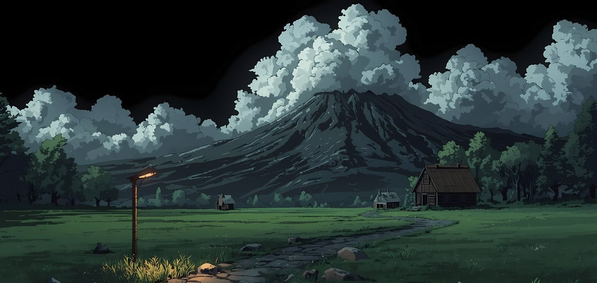
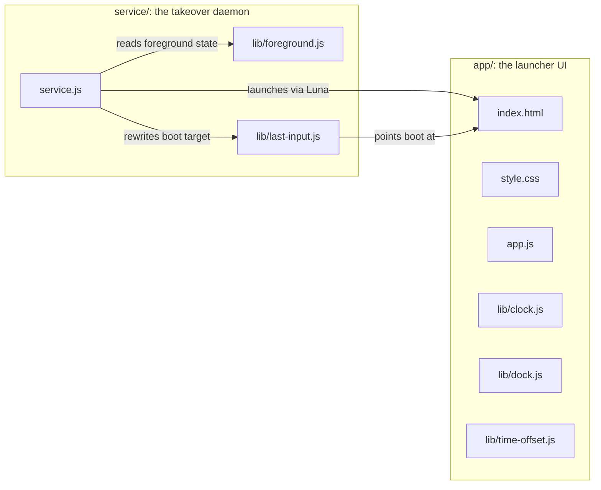
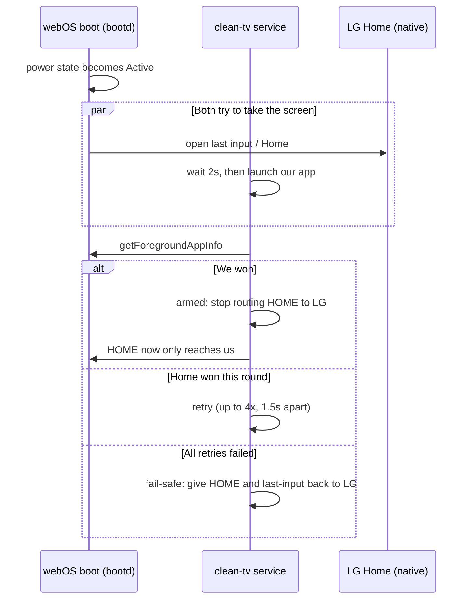

# clean-tv

A clean Home screen for a rooted LG webOS 4 TV: clock, photo background, a dock
of apps. It falls back to LG's stock Home if it fails to load.



The wallpaper photo is the project owner's own, not stock or AI-generated.

Built because no existing launcher supports webOS 4. [cleanyourtv-WebOS](https://github.com/lasharor/cleanyourtv-WebOS)
does the same job on webOS 5+ (systemd required); this project borrows the
*design* of [hbertsch/lgtv-webos-root-launcher](https://github.com/hbertsch/lgtv-webos-root-launcher)
instead (MIT, no code copied), adapted for an older TV with no systemd and a
native, not web-based, stock Home.

## How it works



The launcher (`app/`) is a normal installed web app, same kind as YouTube or
Homebrew Channel. LG's Home on this TV is a native binary; the launcher never
touches it. A background service (`service/`) races LG's Home to the screen at
every power-on and HOME key press. Once it wins once, it tells the system to
stop routing HOME to LG's side.

### The power-on race



## Status

| Piece | State |
|---|---|
| UI logic (`app/lib/*.js`) | Written, tested (17 tests) |
| Service logic (`service/lib/*.js`) | Written, tested (41 tests) |
| UI itself (`app.js`, `style.css`) | Installed and launched on the real TV; dock (5 tiles, looping), top-icons row, and the live-time correction all confirmed working on-device |
| HOME key scan code | Confirmed on this TV |
| Takeover service | Helpers written and tested; the entry point (`service.js`) is not written, so HOME still opens stock LG Home |

Details: [`docs/architecture.md`](docs/architecture.md).

## Decisions (frozen)

- **Scope for v1:** clock, photo background, static app dock, fallback to
  stock Home. No live TV, no voice, no themes, no remote-button escape hatch.
  Debloat is in scope as a follow-on pass, after v1's takeover is proven safe.
- **Target:** webOS 4.0 to 4.10, developed against one rooted LG TV on 4.10.
- **Default dock:** YouTube, Prime Video, Web Browser, Homebrew, Live TV, a
  looping row (past the last tile wraps to the first). Icons are flat white
  glyphs via a CSS mask, not this TV's own colored app icons: see Credit.
- **Top-icons row:** Photo & Video, LG Content Store, Settings, a separate
  focus zone reached with Up/Down from the dock.
- **License:** MIT.

## Develop

```sh
npm test
```

Runs every test in `tests/`: UI logic and service logic, 58 total. No browser,
no TV needed.

## Credit

The takeover mechanism (racing HOME/power-on, the disable-Home flag, the
last-input rewrite, the fail-safe arm/fail state machine) is adapted from
[hbertsch/lgtv-webos-root-launcher](https://github.com/hbertsch/lgtv-webos-root-launcher)
(MIT), built there for a 2021 webOS 6 TV. No code from that repository is
copied; every file here is written fresh for webOS 4.10's older Node
(v0.12.2) and its Upstart-based (not systemd) boot process.

The visual design, clock top-left, photo background, bottom dock, and the
"glass" look on the dock itself, is adapted from
[nthnclrk/CleanFrame](https://github.com/nthnclrk/CleanFrame) (MIT), built
for Samsung The Frame (Tizen), a different OS entirely. The glass effect
there is plain gradients and an inset highlight, no `backdrop-filter`, which
is what this TV's decade-old WebKit engine can render. The blur behind the
dock is a duplicated, blurred copy of the wallpaper (the `filter` property,
not `backdrop-filter`). It shows in a desktop browser and not in a screenshot
from the TV; the cause is unknown, there are no devtools on that engine. The
fallback is the plain gradient.

**Icons** are flat white glyphs rendered via a CSS mask, not this TV's own
colored app icons (those came back inconsistent, different brand colors
each, and YouTube's only on-device asset is a wordmark banner, never a
square mark). `youtube.svg` and `primevideo.svg` are CleanFrame's own
bundled icon pack (same repo, MIT). `globe.svg`, `tv.svg`, `beer.svg`,
`image.svg`, `grid.svg`, and `settings.svg` are from
[Lucide](https://lucide.dev) (ISC), pinned to v0.460.0.
