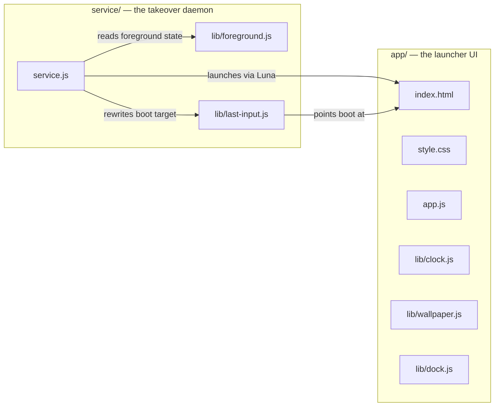
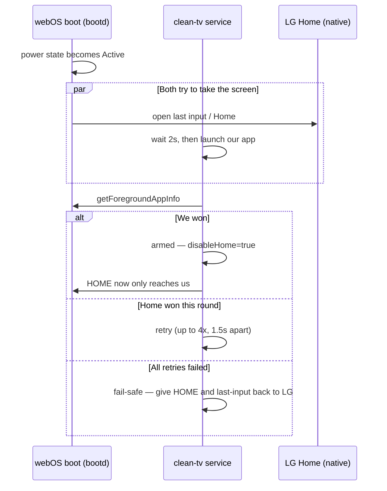

# clean-tv

A clean Home screen for a rooted LG webOS 4 TV: clock, photo background, a dock
of apps, and a safe fallback to LG's stock Home if it fails to load.


Built because no existing launcher supports webOS 4. [cleanyourtv-WebOS](https://github.com/lasharor/cleanyourtv-WebOS)
does the same job on webOS 5+ (systemd required); this project borrows the
*design* of [hbertsch/lgtv-webos-root-launcher](https://github.com/hbertsch/lgtv-webos-root-launcher)
instead (MIT, no code copied), adapted for an older TV with no systemd and a
native, not web-based, stock Home.

## How it works



The launcher (`app/`) is a normal installed web app, same kind as YouTube or
Homebrew Channel. It never touches LG's Home at all, doesn't matter that this
TV's Home is a compiled native binary, not HTML. Instead, a background
service (`service/`) races LG's Home to the screen at every power-on and HOME
key press, and once it wins once, tells the system to stop routing HOME to
LG's side entirely.

### The power-on race



Nothing is ever taken from LG on a guess: the fail-safe gate only arms after
our app has actually been confirmed on screen once.

## Status

| Piece | State |
|---|---|
| UI logic (`app/lib/*.js`) | Written, tested (8 tests) |
| Service logic (`service/lib/*.js`) | Written, tested (13 tests) |
| Live HOME key scan code | Confirmed on this TV: `773` |
| Live Luna APIs the service needs | Confirmed present on this TV |
| The service's own entry point (`service.js`) | Not yet written |
| Installed and tested on the TV | Not yet |

Everything above the entry point has been checked against the real TV before
being trusted: see [`docs/architecture.md`](docs/architecture.md) for exactly
what was verified, live, and how.

## Decisions (frozen)

- **Scope for v1:** clock, photo background, static app dock, fallback to
  stock Home. No live TV, no voice, no themes, no remote-button escape hatch.
  Debloat is in scope as a follow-on pass, after v1's takeover is proven safe.
- **Target:** webOS 4.0–4.10, tested against a rooted 43LM5700PTC
  (firmware 05.40.97).
- **Default dock:** YouTube, Prime Video, Web Browser, Homebrew Channel.
  Real icons read from each app's own folder on the TV, never bundled.
- **License:** MIT.

## Develop

```sh
npm test
```

Runs every test in `tests/`: UI logic and service logic, 21 total. Opens no
browser and touches no TV.

## Credit

The takeover mechanism (racing HOME/power-on, `disableHome`, the last-input
rewrite, the fail-safe arm/fail state machine) is adapted from
[hbertsch/lgtv-webos-root-launcher](https://github.com/hbertsch/lgtv-webos-root-launcher)
(MIT), built there for a 2021 webOS 6 TV. No code from that repository is
copied; every file here is written fresh for webOS 4.10's older Node
(v0.12.2, confirmed live) and its Upstart-based (not systemd) boot process.

The visual design, clock top-left, photo background, bottom dock, and the
"glass" look on the dock itself, is adapted from
[nthnclrk/CleanFrame](https://github.com/nthnclrk/CleanFrame) (MIT), built
for Samsung The Frame (Tizen), a different OS entirely. The glass effect
there turned out to be plain gradients and an inset highlight, no
`backdrop-filter`, which happens to be exactly what this TV's decade-old
WebKit engine can actually render.
